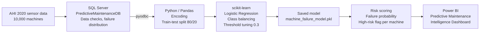

# AI-Driven Predictive Maintenance System

**End-to-end predictive maintenance pipeline on 10,000 industrial machines: sensor data in SQL Server, a failure prediction model in Python (scikit-learn) tuned for business risk, and a Power BI dashboard that shows which machines need attention first.**


---

## At a Glance

| Metric | Result |
|---|---|
| Machines analysed | **10,000** (AI4I 2020 industrial sensor dataset) |
| Machine failures | **339** (failure rate **3.39%**) |
| Model | **Logistic Regression** with class balancing and threshold tuning |
| ROC-AUC | **0.90** |
| Failure recall | improved from **30%** (default model) to **85%** (balanced) and **89%** (threshold 0.3) |
| Strongest warning signal | **Tool wear above ~200 minutes** sharply raises failure probability |
| Output | Failure probability and **high-risk flag for every machine**, visualised in Power BI |

---

## Dashboard


- **KPI cards:** total failures, failure rate, average air temperature and torque, total and high-risk machines, average and maximum risk score
- **Impact of tool wear on failure probability:** risk stays low until about 200 minutes of tool wear, then rises steeply
- **Failure risk across torque levels:** risk is highest at very low and very high torque
- **Machine risk distribution:** low, medium and high risk machines
- **Failure volume by machine type:** L, M and H quality variants
- **Top risk machines:** a ranked list of machines with the highest failure probability, ready for the maintenance team

---

## Business Problem

Unplanned machine failures stop production lines and are far more expensive than planned maintenance. The maintenance team needs to know:

1. **Which machines are most likely to fail?**
2. **Which sensor signals warn of a failure early?**
3. **How should the model be tuned so that failures are not missed?**

---

## Key Insights

1. **Failures are rare but expensive.** Only **3.39%** of machines failed (339 of 10,000), which makes this an imbalanced classification problem where accuracy alone is misleading.
2. **Tool wear is the clearest early warning.** Failure probability stays low for most of the tool's life and climbs sharply **above ~200 minutes** of tool wear.
3. **Torque has a U-shaped risk pattern.** Failure risk is highest at **very low torque (below ~15 Nm)** and **very high torque (above ~60 Nm)**, and lowest in the normal operating range.
4. **Low-quality machines fail most.** Type **L** machines account for **235 failures**, compared to 83 for type M and 21 for type H.

### Recommendations

- **Replace tools before ~200 minutes of wear** as part of planned maintenance.
- **Monitor torque in real time** and trigger an alert outside the normal operating range.
- **Inspect the top-risk machines first**, using the ranked list in the dashboard.

---

## Machine Learning: Accuracy Is Not Enough

The first model reached **97.4% accuracy**, but it only caught **30% of failures**: it mostly predicted "no failure", which is right for 96.6% of machines anyway. That's useless for maintenance.

| Model | Accuracy | Failure Recall | Failure Precision | Comment |
|---|---|---|---|---|
| Logistic Regression (default) | 97.4% | 30% | 67% | Misses 70% of failures |
| Logistic Regression (balanced) | 82% | **85%** | 13% | ROC-AUC **0.90** |
| Balanced + threshold **0.3** | 69% | **89%** | 8% | Final model for risk scoring |

**Why lower the threshold?** In predictive maintenance, a **missed failure** (production stop) costs far more than a **false alarm** (an extra inspection). Lowering the threshold from 0.5 to 0.3 deliberately trades precision for recall, so almost 9 out of 10 failures are caught. This is a business decision, not just a technical one.

**Main drivers (model coefficients):** higher air temperature and machine type L increase failure risk, higher torque increases it further, and higher process temperature (relative to air temperature) reduces it.

---

## Architecture



1. **SQL Server:** the sensor data is stored in `PredictiveMaintenanceDB`, with data checks, failure distribution and average sensor values in SQL.
2. **Python connection:** data is loaded directly from SQL Server into Pandas with `pyodbc`.
3. **Preparation:** one-hot encoding of the machine type and an 80/20 train-test split.
4. **Modelling:** Logistic Regression, class balancing, ROC-AUC evaluation and threshold tuning.
5. **Deployment:** the model is saved as `machine_failure_model.pkl` with `joblib` and scores every machine.
6. **Reporting:** failure probability and high-risk flag per machine are exported and visualised in Power BI.

---

## Tech Stack

| Area | Tools |
|---|---|
| Database | SQL Server, SSMS |
| Data connection | pyodbc |
| Data preparation | Python, Pandas, NumPy |
| Machine learning | scikit-learn (Logistic Regression, ROC-AUC, threshold tuning), joblib |
| Visualisation | Power BI, Matplotlib, Seaborn |

---

## Repository Structure

```
AI-Predictive-Maintenance/
├── ai4i2020.csv                          # Sensor dataset: 10,000 machines
├── sql_scripts.sql                       # Database, table and data checks in SQL Server
├── ml_pipline.ipynb                      # Full ML pipeline: SQL to model to risk scores
├── machine_failure_model.pkl             # Trained model (balanced Logistic Regression)
├── Ai business project  powerbi.pbix     # Power BI dashboard
├── Screenshot 2026-03-21 084610.png      # Dashboard screenshot
├── architecture_predictive_maintenance.png
└── README.md
```

### Dataset

The [AI4I 2020 Predictive Maintenance Dataset](https://archive.ics.uci.edu/dataset/601/ai4i+2020+predictive+maintenance+dataset) (UCI Machine Learning Repository) contains air and process temperature, rotational speed, torque, tool wear, machine type (L, M, H) and a machine failure label.

---

## How to Run

```bash
# 1. Clone the repository
git clone https://github.com/Mayureshp21/AI-Predictive-Maintenance.git
cd AI-Predictive-Maintenance

# 2. Install dependencies
pip install pandas numpy scikit-learn pyodbc matplotlib seaborn joblib jupyter

# 3. Open the notebook
jupyter notebook ml_pipline.ipynb
```

- **SQL Server:** run `sql_scripts.sql`, import `ai4i2020.csv`, and update the server name in the notebook's `pyodbc.connect()` call.
- **Without SQL Server:** load the data directly with `pd.read_csv("ai4i2020.csv")` and continue from the encoding step.
- **Dashboard:** open the `.pbix` file in Power BI Desktop.

---

## Next Steps

- Test **Random Forest** and **XGBoost** to raise precision while keeping high recall
- Predict the **failure type** (tool wear, heat dissipation, power, overstrain) instead of only "failure yes/no"
- Add **cost-based threshold optimisation** using real maintenance and downtime costs
- Stream live sensor data and refresh the risk scores automatically

---

## Author

**Mayuresh Parche**
M.Sc. Software Engineering, Hochschule Heilbronn | SAP Certified Data Analyst (SAP Analytics Cloud)

[LinkedIn](https://www.linkedin.com/in/mayureshparche/) | [GitHub](https://github.com/Mayureshp21)
